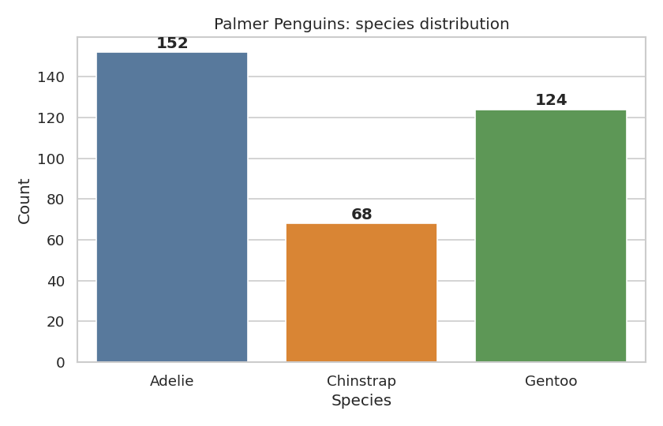
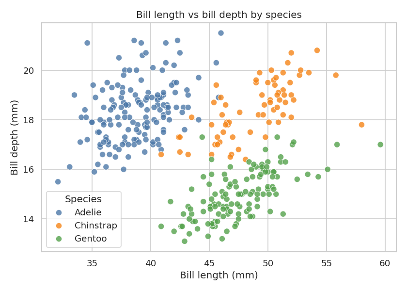
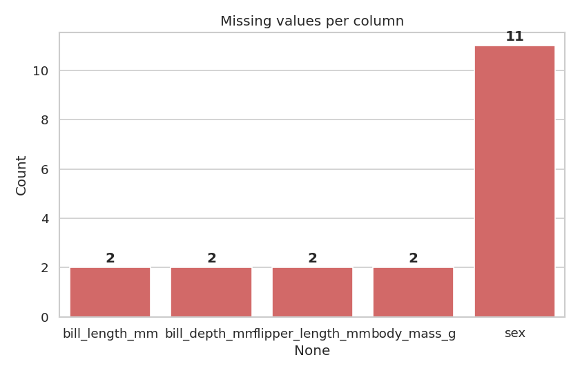
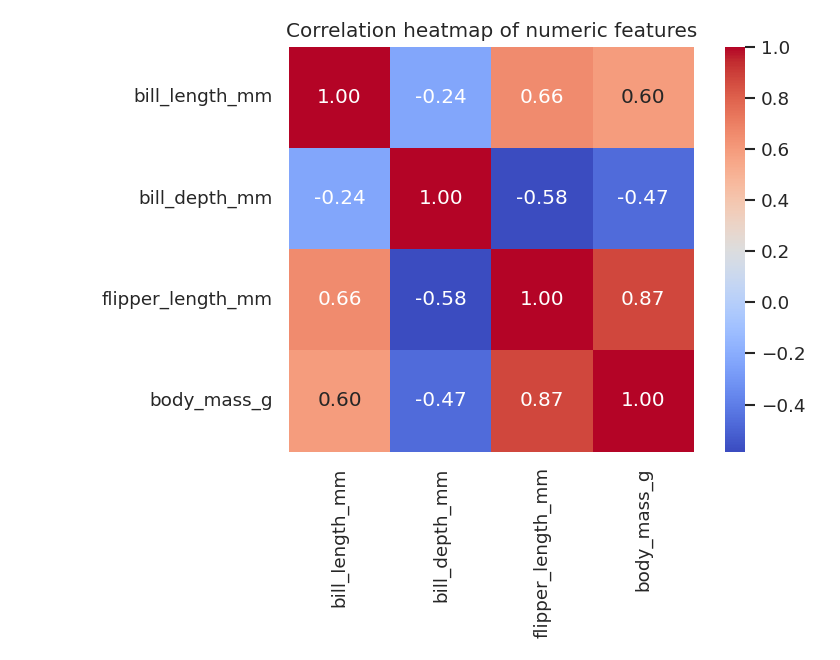
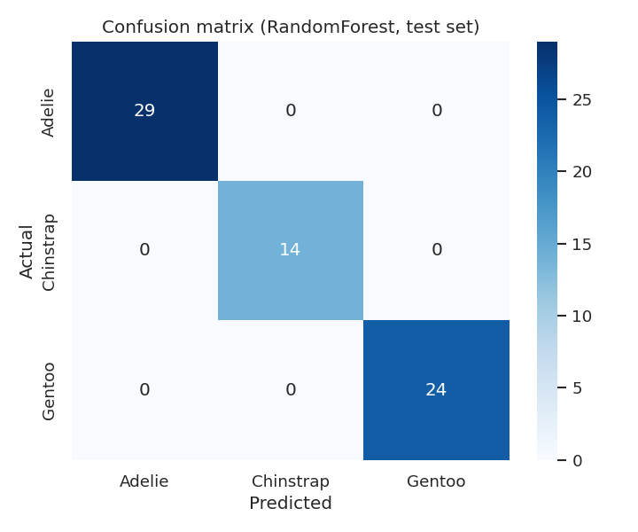

# Penguin Species Classification (scikit-learn)

EDA + classification on the **Palmer Penguins** dataset: given body measurements
(bill length/depth, flipper length, body mass) plus island and sex, predict the
penguin species — Adelie, Chinstrap, or Gentoo.

Built as a clean, fully reproducible ML pipeline: data cleaning, exploratory
analysis, model comparison with cross-validation, and honest evaluation.
Every number below was measured by running the code, not estimated.

## Dataset

- `data/penguins.csv` — the public Palmer Penguins dataset (Horst et al., 2020),
  344 rows x 7 columns, bundled in the repo so the pipeline runs offline.
- 11 rows (3.2%) have missing values (2 incomplete measurement rows, 11 missing
  `sex` entries) — dropped during cleaning, 333 rows kept.
- Class distribution: **Adelie 152, Gentoo 124, Chinstrap 68** — imbalanced but
  every class well represented.

## EDA findings (measured, `src/eda.py`)




- Median profiles per species:
  - **Adelie**: bill 38.8 mm, depth 18.4 mm, flipper 190 mm, mass 3700 g
  - **Chinstrap**: bill 49.55 mm, depth 18.45 mm, flipper 196 mm, mass 3700 g
  - **Gentoo**: bill 47.3 mm, depth 15.0 mm, flipper 216 mm, mass 5000 g
- Gentoo separates cleanly: heaviest body mass, longest flippers, shallowest
  bills. Adelie vs Chinstrap differ mainly in bill length.
- Correlation heatmap: body mass tracks flipper length closely.




## Modeling (`src/train.py`)

- Preprocessing: drop 11 incomplete rows, one-hot encode `island` + `sex`
  → 9 features (`bill_length_mm`, `bill_depth_mm`, `flipper_length_mm`,
  `body_mass_g`, 3 island dummies, 2 sex dummies).
- Split: stratified 80/20, `random_state=42` (train 266, test 67).
- Two pipelines compared: `StandardScaler + LogisticRegression` vs
  `StandardScaler + RandomForestClassifier`.

| Model | 5-fold CV accuracy (train) | Test accuracy | Test macro F1 |
|---|---|---|---|
| Logistic Regression | 0.9963 ± 0.0074 | 0.9851 | 0.9827 |
| Random Forest | 0.9887 ± 0.0092 | **1.0000** | **1.0000** |

Test-set classification report (Random Forest — 67 samples, 0 misclassifications):

| Species | Precision | Recall | F1 |
|---|---|---|---|
| Adelie (29) | 1.00 | 1.00 | 1.00 |
| Chinstrap (14) | 1.00 | 1.00 | 1.00 |
| Gentoo (24) | 1.00 | 1.00 | 1.00 |



Top-3 Random Forest feature importances: `bill_length_mm` 0.339,
`flipper_length_mm` 0.266, `bill_depth_mm` 0.147.

**Honest note:** this is a cleanly separable dataset, so the perfect test score
reflects an easy problem on 67 test samples rather than a breakthrough — the
5-fold CV figure (~0.99) is the fairer estimate of generalization. This repo is
a reproducible baseline pipeline, not a claim of a hard-won result.

## How to run

```bash
pip install -r requirements.txt
python3 src/eda.py     # prints EDA summary, saves 4 charts to assets/
python3 src/train.py   # CV + test evaluation, saves confusion matrix
```

## Tech stack

Python, pandas, NumPy, scikit-learn, matplotlib, seaborn.

## License

MIT — see [LICENSE](LICENSE).
